<picture>
  <source media="(prefers-color-scheme: dark)" srcset="assets/brand/notelac-logo-light.png">
  
</picture>

# Checkpoint Capture — mobile app

A mobile app (Android & iOS) for race checkpoints. It photographs every participant crossing the
checkpoint in short bursts, can record 16:9 video, stamps each frame with the checkpoint and the
exact time to the millisecond, and uploads everything to the race server — even after the network drops.

**📄 UI walkthrough (PDF):** [docs/Notelac-Checkpoint-Capture-UI.pdf](docs/Notelac-Checkpoint-Capture-UI.pdf) —
all 14 screens in light and dark mode, with notes and design tokens.

## Screens

| Login | Checkpoint | Camera setup | Live capture |
| --- | --- | --- | --- |
| 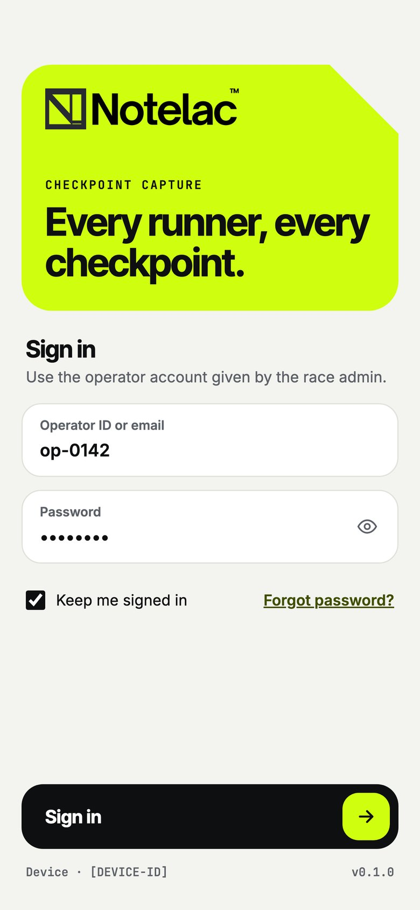 | 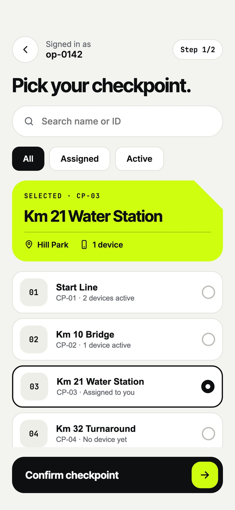 | 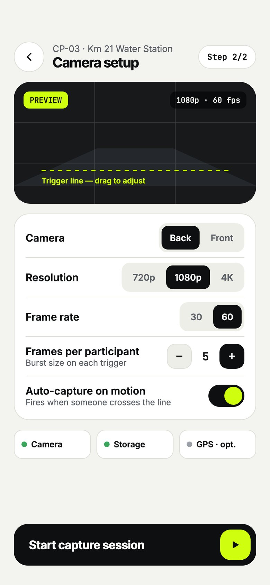 | 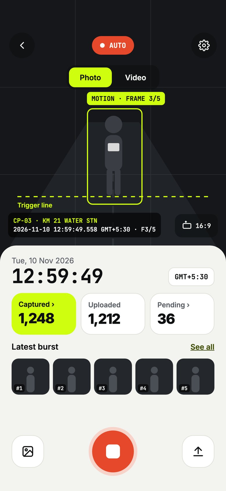 |
| **Gallery** | **Image detail** | **Upload & sync** | **Session summary** |
| 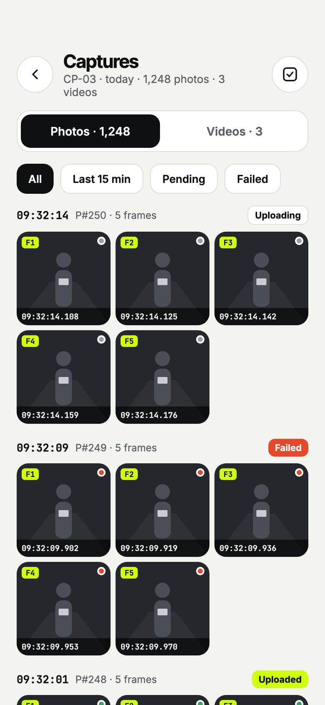 | 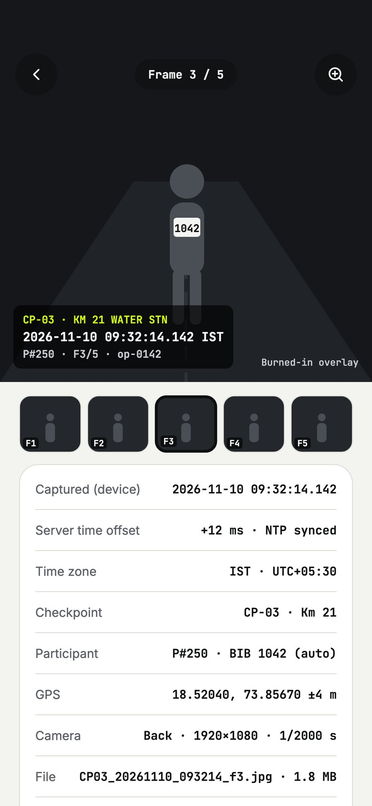 | 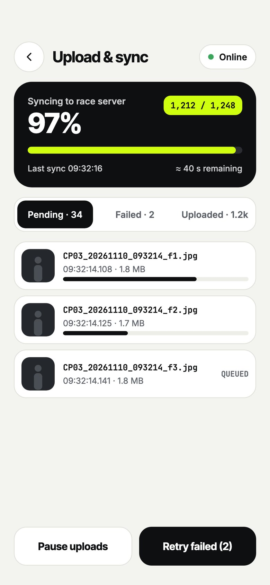 | 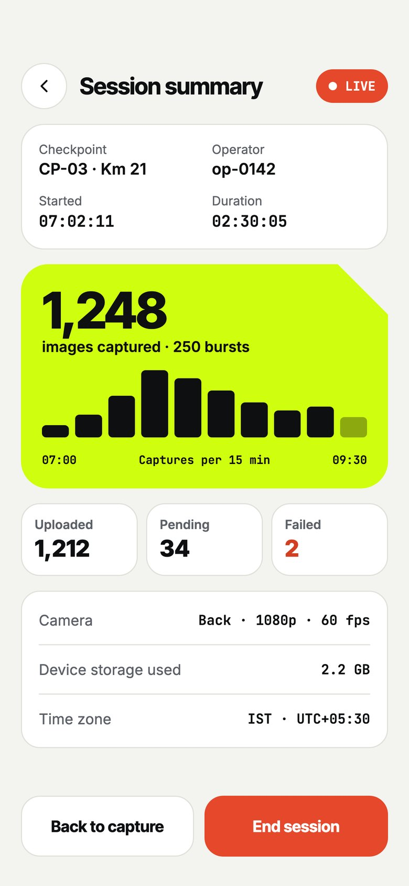 |
| **Settings** | **Device health** | **Session history** | **Alerts & states** |
| 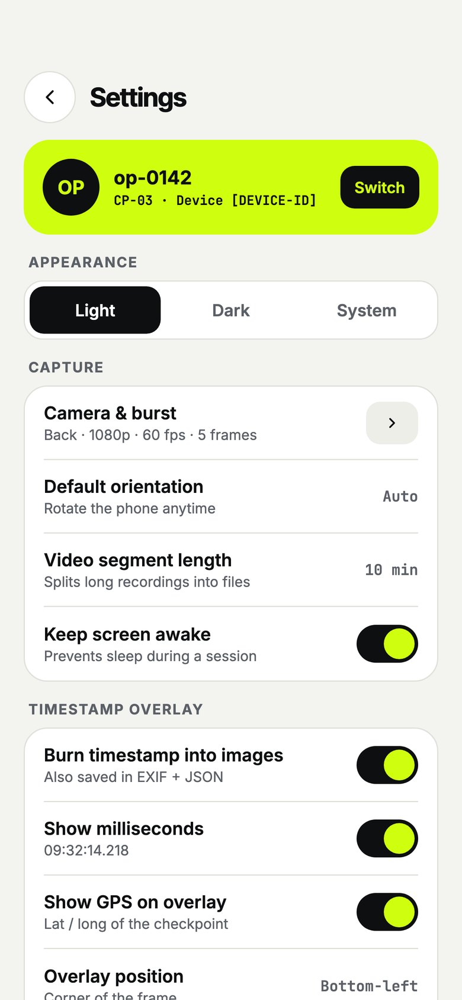 | 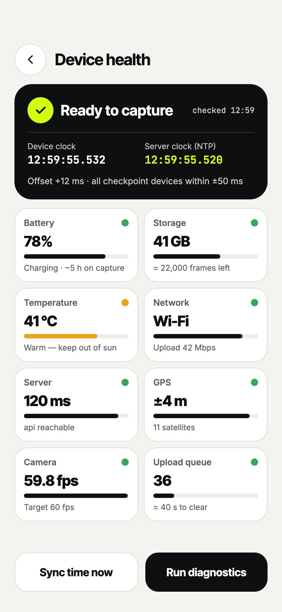 | 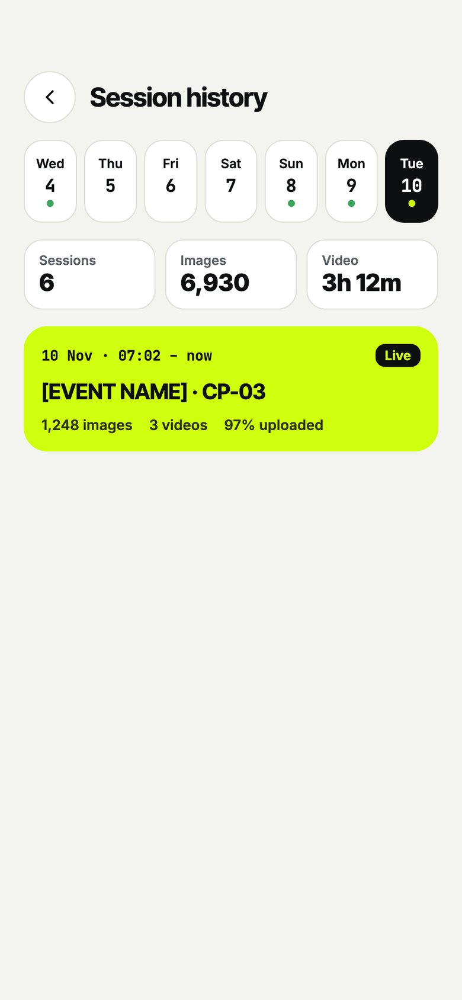 | 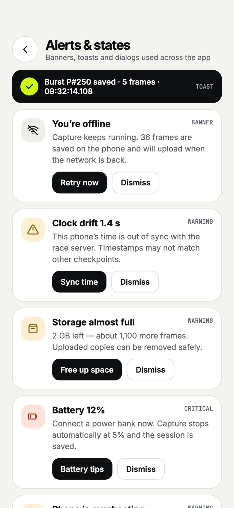 |

**Landscape 16:9 video** — tilt the phone while capturing:

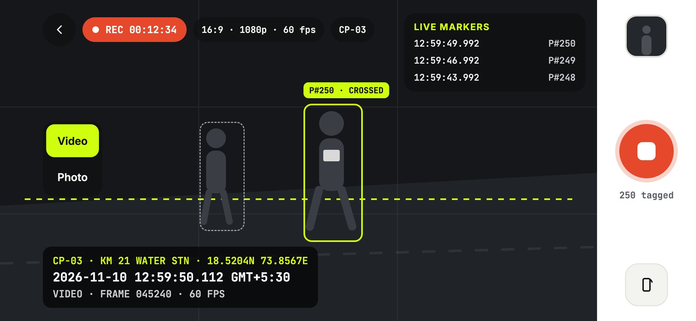

**Dark mode** — every screen has one (switch in Settings → Appearance):

| 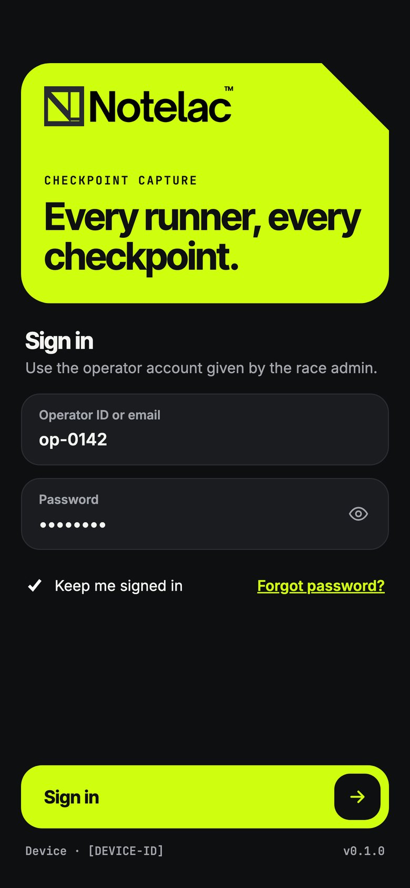 | 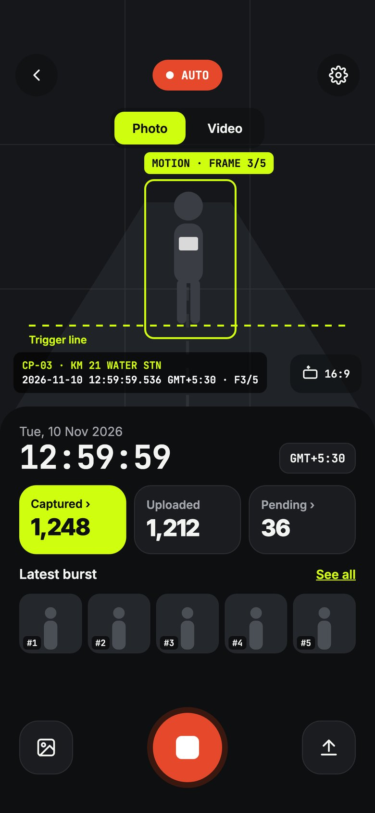 | 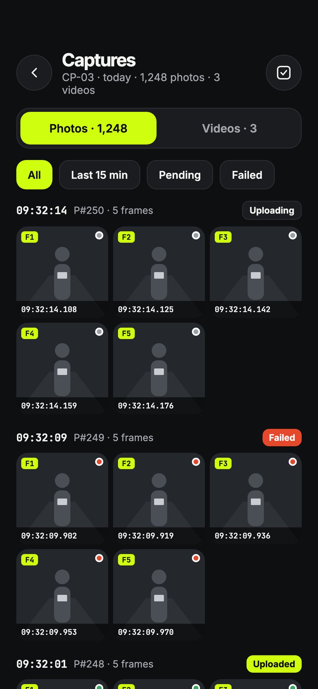 | 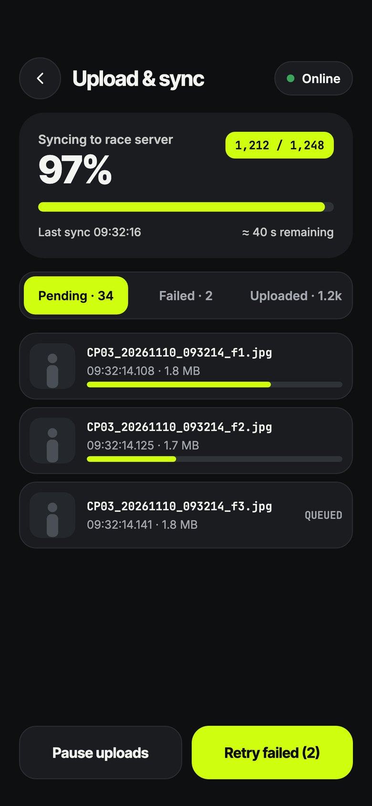 |
| --- | --- | --- | --- |

## Features

- **Checkpoint workflow** — sign in, pick the checkpoint, set up the camera, start a session.
- **Photo bursts** — 1–10 frames per runner, triggered by motion (beta), a timer, or a tap.
- **16:9 video** — rotate to landscape; long recordings split into segments; tap *Mark runner* at each crossing.
- **Burned-in timestamp** — checkpoint · date · time to the millisecond · time zone · runner/frame on every photo,
  plus a JSON metadata file. Time is corrected by syncing with the race server clock.
- **Offline first** — everything is saved on the phone first; the upload queue retries automatically.
- **Review** — gallery grouped by runner, full-frame detail with all metadata, BIB tagging, re-upload.
- **Operations** — session summary and history, device health (battery, storage, network, clock, GPS), alerts.
- **Light / dark / system theme** in the Notelac brand colours.

## Run it in Expo Go

Needs Node.js 20+ and the **Expo Go** app (SDK 58) on your phone.

```bash
git clone <this repo>
cd notelac-checkpoint-capture
npm install
npx expo start
```

Scan the QR code with the **Expo Go** app (Android) or the Camera app (iOS). Phone and Mac must be on
the same Wi-Fi; if they are not, use `npx expo start --tunnel`. The camera does not work in simulators.

### Test accounts & sample data

Sign in with one of the test accounts in `src/data/demo.ts`. The login screen also lists them under
**Test accounts**; one tap signs in and picks that account's checkpoint.

With **Load sample photos** ticked (default), the first sign-in adds sample data built from the bundled
runner photos in `assets/demo/` (BIB 1042, 2187, 0563):

| Session | Checkpoint | Bursts | Upload state |
| --- | --- | --- | --- |
| 3 days ago (ended) | CP-01 Start Line | 3 | all uploaded |
| Yesterday (ended) | CP-03 Water Station | 6 | 1 failed → shows “Needs upload” |
| Today (live, last 40 min) | the account's checkpoint | 9 | 6 uploaded, 1 failed, 2 pending |

Each sample frame goes through the real stamper, so it gets the burned-in timestamp.
Settings → **Test data** can load another set or clear everything on the phone.

## Screens (`src/app/`)

| Route | Screen |
| --- | --- |
| `login` | Sign in |
| `permissions` | Camera / microphone / location |
| `checkpoint` | Pick the checkpoint |
| `camera-setup` | Lens, video quality, burst size, trigger (motion / timer / tap), overlay |
| `capture` | Live capture — portrait, or rotate to **16:9 landscape**; Photo bursts or Video with runner markers |
| `gallery` | Photos grouped by runner, videos with markers |
| `image/[id]` | Full frame with burned-in timestamp, burst strip, metadata, BIB tag, re-upload; video playback with live timestamp |
| `uploads` | Upload queue: pending / failed / done, pause, retry |
| `summary` | Session stats, captures per 15 min, end session |
| `history` | Past sessions by day |
| `settings` | Theme (light/dark/system), overlay, server URL, Wi-Fi only, storage, sign out |
| `health` | Battery, storage, network, clock offset, GPS, queue |
| `alerts` | Every warning the app can show |

## How capture works

- **Timestamp**: taken from the device clock plus the offset from the last server time sync,
  to the millisecond. It is burned into each photo (bottom-left: checkpoint · date · time · zone · runner/frame)
  and written to a JSON sidecar next to the file.
- **Burned-in overlay**: `src/components/Stamper.tsx` renders the photo and overlay off-screen and
  snapshots it with `react-native-view-shot` — works in Expo Go.
- **Video**: recorded in segments (5/10/15 min). Pixels are not stamped in Expo Go; instead the start
  time and each "Mark runner" press are saved in the sidecar, and playback shows the exact time on top.
- **Motion trigger (beta)**: Expo Go has no camera frame access, so the app takes tiny probe snapshots
  and fires a burst when the scene changes. For real motion / person detection build a development build
  with `react-native-vision-camera` frame processors.
- **Offline first**: files are stored in the app's documents folder (`notelac/<session>/`); the queue
  uploads oldest first, 2 at a time, retries failures every 30 s (10 tries), and survives app restarts.

## Server API the app expects

Leave the server URL empty in Settings for **demo mode** (uploads are simulated).

| Call | Purpose |
| --- | --- |
| `GET {apiUrl}/time` → `{ "epochMs": 1794291234567 }` | Clock sync (NTP-style, half round trip) |
| `POST {apiUrl}/captures` multipart: `file`, `metadata` (JSON string), `captureId`, `checkpointId`, `capturedAt` | Upload one photo or video |

`Authorization: Bearer <token>` is sent when a token is set. Any non-2xx response counts as a failure and is retried.

Metadata JSON example:

```json
{
  "id": "m3k2x9a1b2c",
  "kind": "photo",
  "capturedAt": "2026-11-10T04:02:14.218Z",
  "capturedAtMs": 1794283334218,
  "deviceTimeMs": 1794283334206,
  "timeZone": "IST",
  "utcOffset": "UTC+05:30",
  "checkpoint": { "id": "CP-03", "name": "Km 21 Water Station", "lat": 18.5204, "lng": 73.8567 },
  "gps": { "lat": 18.52041, "lng": 73.85668 },
  "sessionId": "m3k1...",
  "operator": "op-0142",
  "participant": 250,
  "frame": 3,
  "frames": 5
}
```

## Still to connect

- Real login and checkpoint list from the backend (`src/app/login.tsx`, `src/data/checkpoints.ts`).
- BIB tags are stored locally and in the app state; send them to the server once an endpoint exists.

## Project structure

```
src/app/          screens (Expo Router — one file per route)
src/components/   UI kit, timestamp overlay, stamper, banners
src/services/     time sync, media saving, upload queue, sample data
src/store/        settings + captures/sessions stores (persisted on the phone)
src/data/         checkpoints and test accounts (replace with the backend)
assets/brand/     Notelac logo
docs/             UI PDF and screenshots
```

Tech: Expo SDK 58 · React Native · TypeScript · Expo Router · expo-camera · expo-file-system ·
expo-video · react-native-view-shot.

## Checks

```bash
npx tsc --noEmit
npx expo lint
npx expo-doctor
```
